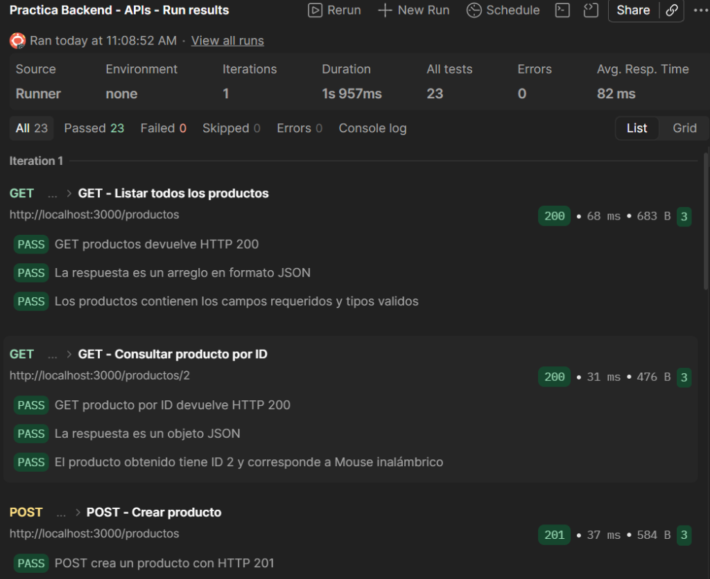
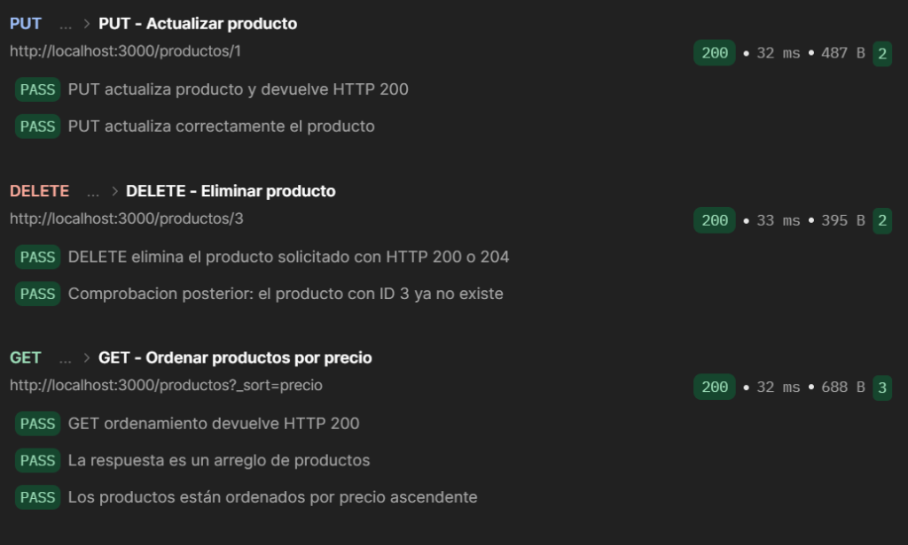
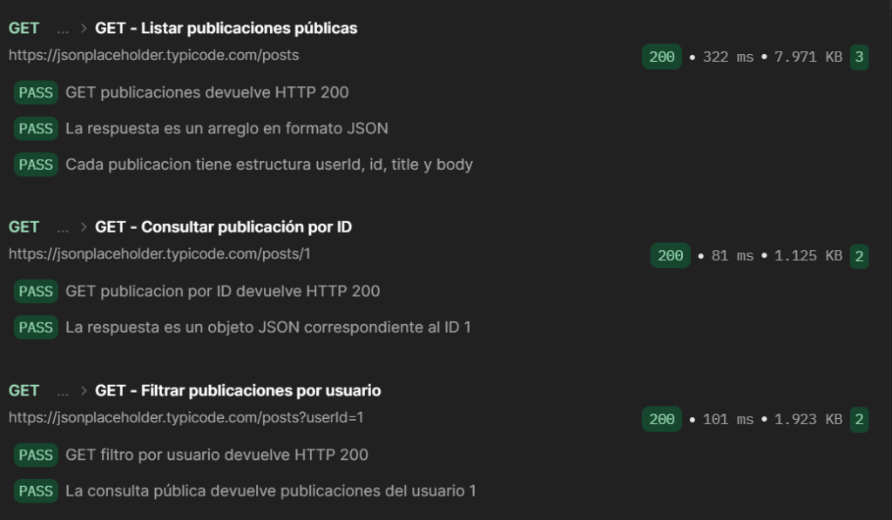

# Evidencias de Ejecución en Postman

Este documento contiene el registro de las evidencias obtenidas directamente desde **Postman Collection Runner**, demostrando la ejecución exitosa de las 9 peticiones y las 23 aserciones automatizadas (100% aprobadas).

---

## 1. Resumen de Ejecución en Collection Runner

- **Colección:** `Practica Backend - APIs`
- **Total de pruebas ejecutadas:** 23
- **Pruebas aprobadas (Passed):** 23 (100%)
- **Pruebas fallidas (Failed):** 0
- **Errores:** 0
- **Tiempo promedio de respuesta:** ~82 ms

---

## 2. Capturas de Pantalla Adjuntas

### Captura 1: API Local — Consultas iniciales y Creación
**Archivo:** [`01_runner_parte1_get_y_post.png`](01_runner_parte1_get_y_post.png)  
Muestra:
- Resumen global de ejecución del Runner (`23 Passed, 0 Failed`).
- `GET - Listar todos los productos` (Status `200 OK`, 3/3 tests PASS).
- `GET - Consultar producto por ID` (Status `200 OK`, 3/3 tests PASS).
- `POST - Crear producto` (Status `201 Created`, 3/3 tests PASS).

---

### Captura 2: API Local — Actualización, Eliminación y Ordenamiento
**Archivo:** [`02_runner_parte2_put_delete_sort.png`](02_runner_parte2_put_delete_sort.png)  
Muestra:
- `PUT - Actualizar producto` (Status `200 OK`, 2/2 tests PASS).
- `DELETE - Eliminar producto` (Status `200 OK`, 2/2 tests PASS, incluyendo la comprobación posterior de ausencia).
- `GET - Ordenar productos por precio` (Status `200 OK`, 3/3 tests PASS, validación de orden ascendente numérico).

---

### Captura 3: API Pública — Listar, Detalle y Filtrado
**Archivo:** [`03_runner_parte3_api_publica.png`](03_runner_parte3_api_publica.png)  
Muestra:
- `GET - Listar publicaciones públicas` (Status `200 OK`, 3/3 tests PASS).
- `GET - Consultar publicación por ID` (Status `200 OK`, 2/2 tests PASS).
- `GET - Filtrar publicaciones por usuario` (Status `200 OK`, 2/2 tests PASS, validando que todas pertenezcan a `userId=1`).

---

## 3. Lista de Comprobación Final

- [x] Evidencia de listado de productos locales (GET).
- [x] Evidencia de consulta por ID (GET).
- [x] Evidencia de inserción de producto (POST con 201 Created).
- [x] Evidencia de actualización (PUT con 200 OK).
- [x] Evidencia de eliminación (DELETE con 200 OK y verificación posterior).
- [x] Evidencia de ordenamiento numérico por precio (`?_sort=precio`).
- [x] Evidencia de consumo de publicaciones públicas (GET).
- [x] Evidencia de consulta por ID público (GET).
- [x] Evidencia de filtrado público por usuario (`?userId=1`).
- [x] Resumen de 23/23 tests en verde sin fallos.
